# 같이 통합 기획서 (요구사항 + 설계)

2026-10-12 · v3.2 (외부 리뷰 반영)

## 1. 개요

| 항목 | 내용 |
| --- | --- |
| 서비스명 | 같이 |
| 한 줄 소개 | 자취생 이웃끼리 대용량 상품을 같이 사서 몫으로 나누고, 남은 것은 나눔으로 마감하는 서비스 |
| 타겟 플랫폼 | 모바일 웹 (폭 360~430px, PC에서는 가운데 정렬) |
| 개발 조건 | 24시간 해커톤, MVP, 무료 플랜 범위 안에서 운영하는 것이 목표 |
| 작성일 | 2026-10-12 |

몫이 모두 차면 성사되고, 마감까지 차지 않으면 무산됩니다. 24시간 해커톤에서 이 한 흐름이 데모로 돌아가는 최소 기능(MVP)만 만듭니다.

- **문제**: 자취생은 과일, 계란, 휴지처럼 대용량으로만 파는 물건이 비싸고, 혼자 쓰다 남아서 버립니다.
- **해결**: 같이 사서 몫으로 나눕니다(같이사기). 이미 남은 것은 몫 1개짜리로 올려 나눕니다(나눔). 둘은 같은 구조의 서로 다른 설정입니다.
- **목표**: 가입 → 같이사기 개설 → 이웃이 몫 신청 → 몫이 차면 성사 → 개설자와 참여자가 만날 정보 확인까지 한 흐름을 데모로 보여 줍니다.
- **제출 요건 충족**: DB 설계, API 서버, 웹 서비스 3가지를 모두 갖추고, 회원가입을 필수로 합니다.
- **발표 포인트**: ① 마지막 한 몫을 여러 명이 동시에 신청할 때 DB가 한 명만 통과시키는 방법(스크립트로 시연), ② 마감을 상태가 아니라 시각(deadline)으로 판단하는 방법. 상태 컬럼은 결과만 기록합니다.
- **소재 범위**: 과일·채소, 식품, 생필품처럼 몫으로 나눌 수 있는 상품. 배달 공동주문은 금액 합산과 결제가 필요해 로드맵으로 둡니다.
- **개설자의 몫**: 개설자는 몫을 가져가지 않습니다. total_slots는 이웃에게 나눌 몫 수이고, 개설자는 자기 글에 신청할 수 없습니다. 개설자 몫이 필요하면 몫 수에서 빼고 입력합니다.

## 2. 용어 정의

문서, 코드, 화면에서 같은 대상을 같은 이름으로 부릅니다.

| 화면 용어 | 코드 / DB | 정의 |
| --- | --- | --- |
| 회원 | `users` | 이메일로 가입한 계정. 한 계정이 개설자와 참여자를 모두 할 수 있다. |
| 글 | `items` | 같이사기 또는 나눔으로 올린 게시물. `type`으로 구분한다. |
| 같이사기 (공구) | `type = GROUP_BUY` | 대용량 상품을 같이 사서 몫으로 나누는 글. 첫 번째 탭. |
| 같이 마감하기 (나눔) | `type = SHARE` | 남은 물건을 1몫, 0원으로 올리는 글. 사진 필수. 두 번째 탭. |
| 몫 | `total_slots`, `filled_slots` | 한 사람이 가져가는 단위. total_slots는 나눌 몫 수, filled_slots는 신청된 몫 수. 개설자 몫은 포함하지 않는다. |
| 몫 신청 | `reservations` | 회원이 글의 몫 1개를 가져가겠다고 확정한 기록. 1인 1몫, 취소 없음. |
| 개설자 / 참여자 | `items.owner_id` / `reservations.user_id` | 글을 올린 사람 / 몫을 신청한 사람. 자기 글에는 신청할 수 없다. |
| 마감 시각 | `deadline` | 같이사기는 모집 마감 시각, 나눔은 유통기한 다음 날 00:00(한국 시간). 이 시각부터 신청할 수 없다(`deadline > now()`일 때만 신청 가능). 나눔은 화면에 "10/13까지"처럼 유통기한 날짜로 표시한다. |
| 모집 중 / 성사 / 무산 / 취소 | `status` = `OPEN` / `CONFIRMED` / `FAILED` / `CANCELED` | 몫을 받는 중 / 몫이 모두 참 / 마감까지 못 참 / 개설자가 모집 중에 접음. |
| 만남 장소 메모 | `pickup_note` | 정확한 만남 장소, 시간, 연락 방법. 개설자와 성사된 글의 참여자에게만 보인다. |

## 3. 사용자와 데모 시나리오

| 역할 | 하고 싶은 일 | 성공 기준 |
| --- | --- | --- |
| 개설자 | 대용량 상품을 사서 이웃과 나누고 싶다. 남은 것을 나눔으로 올리고 싶다. 누가 신청했는지 알고 싶다 | 1분 안에 개설하고, 몫이 차면 성사로 바뀌고, 참여자 닉네임이 보인다 |
| 참여자 | 필요한 만큼만 싸게 사고 싶다. 성사되면 어디서 언제 만나는지 알고 싶다 | 몫 가격, 남은 몫, 마감까지 남은 시간이 보이고 신청이 바로 확정된다. 성사되면 만남 장소 메모가 보인다 |

**만남 방식**: 앱 안에 채팅은 없습니다. 개설자가 만남 장소 메모에 장소, 시간, 연락 방법(예: 오픈채팅 링크)을 한 번에 적으면, 성사된 참여자에게만 그 메모가 열립니다. 작성 폼에 예시 문구("○○아파트 정문, 토 오후 3시, 오픈채팅 링크")를 보여 줍니다.

**데모 시나리오 (3분)**

1. 가입하고 로그인한다.
2. 목록에서 몫이 차오르는 같이사기(예: 샤인머스켓 5몫 중 3몫 신청)를 확인한다.
3. + 버튼으로 몫 1개짜리 같이사기를 작성한다.
4. 터미널에서 동시 신청 스크립트를 돌린다. 요청 10개가 동시에 들어가 1개만 성공(201), 9개는 몫 소진(409 `SLOTS_FULL`)이고 글이 성사로 바뀐다.
5. 내 참여 화면에서 성사된 글의 만남 장소 메모가, 내 글 화면에서 참여자 닉네임이 보이는 것을 확인한다.
6. (나눔 묶음을 완성했을 때만) 같이 마감하기 탭으로 넘어가, 사진을 올린 나눔(1몫, 0원) 글이 같은 방식으로 신청되는 것을 짧게 보여 준다.

> 4번은 휴대폰 두 대로 동시에 누르면 대부분 순서대로 처리되어 동시성이 드러나지 않습니다. 그래서 스크립트로 보여 주고, 화면에서는 결과만 확인합니다.

## 4. 기능 요구사항

Must 7개가 데모의 전부이고, Should는 Must가 끝까지 돌아간 뒤에 얹습니다.

Must는 **같이사기만** 다룹니다. 나눔은 사진이 필수라 사진 업로드 없이는 작성할 수 없으므로, F-07(나눔 탭), F-09(사진 업로드), A-07(업로드 API)을 **나눔 묶음** 하나로 보고 끝까지 완성하거나 통째로 뺍니다. 빼면 두 번째 탭을 숨깁니다. 시드 데이터의 사진은 데모 화면을 채울 뿐 업로드 기능을 대신하지 않습니다.

| ID | 기능 | 설명 | 우선순위 |
| --- | --- | --- | --- |
| F-01 | 회원가입 | 이메일, 비밀번호, 닉네임, 위치로 가입한다. 위치는 브라우저 위치 허용 또는 동네 선택(약 20곳 목록)으로 받고, 서버가 소수점 2자리(약 1km)로 반올림해 저장한다. 이메일은 중복 불가 | Must |
| F-02 | 로그인 | 성공 시 JWT를 발급한다 | Must |
| F-03 | 글 작성 (+ 버튼) | 화면 오른쪽 아래 + 버튼으로 연다. 같이사기 글을 작성한다. 제목, 총 가격, 몫 수(이웃에게 나눌 몫, 몫당 가격은 서버가 올림 계산), 마감 시각, 만남 장소 메모(장소·시간·연락 방법), 상품 링크(선택)를 입력한다. 위치는 기본이 내 위치다. 카테고리는 선택(기본 기타). 사진 입력은 나눔 묶음(F-09)이 완성되면 선택 항목으로 붙인다 | Must |
| F-04 | 메인 목록 | 같이사기 탭이 기본이다. 모집 중(OPEN)이고 마감 전인 글만 보여 준다. 내 위치 기준 가까운 순 또는 마감 임박 순이며, 몫 진행(3/5), 개설자 닉네임, 몫당 가격(올림), 마감 카운트다운을 표시한다. 상품 링크가 있으면 상품 보기 버튼을 둔다. 근처에 글이 없으면 "근처에 글이 없어요"와 글쓰기 버튼을 보여 준다 | Must |
| F-05 | 몫 신청 | 남은 몫이 있고 마감 전일 때만 신청할 수 있다. 동시 요청 시 남은 몫 수만큼만 성공하고, 마지막 몫이 차면 성사로 바뀐다. 한 사람이 한 글에 한 번만, 자기 글에는 신청할 수 없다. 실패 사유는 코드별 안내 문구로 보여 준다 | Must |
| F-06 | 내 참여 조회 | 내가 신청한 목록과 상태(모집 중, 성사, 무산, 취소)를 본다. 성사된 건은 개설자 닉네임과 만남 장소 메모가 보인다 | Must |
| F-11 | 내 개설 글 관리 | 내가 올린 글의 상태와 몫 진행, 신청한 참여자 닉네임, 만남 장소 메모를 본다. 모집 중인 글은 개설을 취소할 수 있다 | Must |
| F-07 | 같이 마감하기 탭 (나눔 묶음) | 두 번째 탭과 나눔 글 작성. 작성 폼은 제목, 유통기한, 만남 장소 메모, 사진(필수)이고 몫 1개, 0원은 서버가 정한다. 목록은 유통기한이 임박한 순으로 사진을 크게 보여 준다. 신청 로직은 같이사기와 같고 신청 즉시 성사된다. F-09가 먼저 있어야 한다 | Should |
| F-08 | 검색 | 검색창에 품목을 입력하면 현재 탭 안에서 제목으로 걸러 보여 준다 | Should |
| F-09 | 사진 업로드 | 글당 1장. 브라우저에서 긴 변 1080px로 줄여 500KB 이하로 올린다(jpeg, png, webp). 외부 저장소에 저장하고 DB에는 주소만 둔다. 카메라 촬영 가능. 나눔 묶음의 첫 단계이고, 완성되면 같이사기 사진(선택)에도 쓴다 | Should |
| F-10 | 반경 필터 | 3km, 5km 선택 (위치를 흐려 저장하므로 1km는 제외) | Should |
| F-12 | 결제, 정산, 몫당 가격의 잔액 분배(합계를 총액과 정확히 맞추기), 배달 공동주문, 상품 링크 자동 채우기, 카테고리 필터, 리뷰, 푸시 알림, 앱 내 채팅, 지도 SDK, 참여자의 신청 취소, 1인 여러 몫, 로그인 시도 제한 | 출시 이후 | Won't |

## 5. 정책

### 5.1 회원과 인증

- 이메일은 형식을 검증하고 소문자로 바꿔 저장하며 UNIQUE입니다.
- 비밀번호는 8자 이상 72바이트 이하이고, bcrypt 해시만 저장합니다. bcrypt는 72바이트를 넘는 입력을 잘라 버리므로 상한을 둡니다.
- 닉네임은 2~20자이고 중복을 허용합니다. 사람을 구분하는 식별자는 이메일과 id입니다.
- 로그인 성공 시 액세스 토큰을 발급하고 만료는 24시간입니다. 토큰에는 사용자 id(`sub`)와 만료 시각(`exp`)만 담습니다.
- 프론트는 토큰을 localStorage에 저장해 모든 요청의 `Authorization: Bearer` 헤더에 실어 보냅니다.
- **알려진 한계**: localStorage는 XSS에 취약하고 토큰은 즉시 폐기가 어렵습니다. 출시 단계에서는 짧은 만료, 리프레시 토큰, HttpOnly 쿠키, 로그인 시도 제한으로 옮기겠다고 발표에서 먼저 말합니다. 이 한계 때문에 데모 기간에는 팀원과 심사자 외 외부 사용자에게 공개하지 않습니다.

### 5.2 위치와 개인정보

- 가입 시 브라우저 위치 허용을 먼저 요청하고, 거부하거나 실패하면 동네 선택 목록(약 20곳, 동네 이름과 대표 좌표)으로 넘어갑니다.
- `lat`, `lng`는 서버가 소수점 2자리(약 1km 격자)로 반올림해 저장합니다. 위도 0.01°는 약 1.1km, 경도 0.01°는 서울 위도에서 약 0.9km라 격자는 정사각형이 아니고, 격자 안의 위치는 한 점으로 뭉쳐집니다. 클라이언트가 보낸 정밀 좌표는 저장하지 않습니다.
- 이 조치는 정확한 위치가 드러날 위험을 **줄일 뿐 없애지는 못합니다**. 인구가 적은 지역에서는 격자 하나에 집이 몇 채뿐일 수 있습니다.
- 글 위치는 기본이 내 저장 위치입니다. 거리는 내 저장 위치와 글 위치 사이로 계산합니다.
- 정확한 만남 장소와 시간, 연락 방법은 `pickup_note`에 두고, 개설자와 성사된 글의 참여자에게만 응답에 넣습니다.
- 같은 격자 안의 글은 거리가 같으므로 마감 임박 순으로 정렬합니다.

### 5.3 글 작성 규칙

| 항목 | 같이사기 (GROUP_BUY) | 나눔 (SHARE) |
| --- | --- | --- |
| 제목 | 1~50자 | 1~50자 |
| 몫 수 | 1~20 (데모에서 1몫 글을 쓴다) | 서버가 1로 정한다 (요청값 무시) |
| 총 가격 | 0원 이상 1,000,000원 이하 | 서버가 0으로 정한다 (요청값 무시) |
| 몫당 가격 | 서버가 `ceil(총 가격 / 몫 수)`로 계산 | 0 |
| 마감 | `deadline`: 현재 이후, 30일 이내 | `expiry_date`(날짜): 오늘부터 30일 이내. 서버가 **다음 날 00:00** 한국 시간으로 바꿔 `deadline`에 저장(그 시각부터 신청 불가). 화면에는 "10/13까지"처럼 유통기한 날짜로 표시 |
| 위치 | 선택, 기본은 내 위치 | 같음 |
| 사진 | 나눔 묶음 완성 후 선택 항목으로 추가 | 필수 (나눔 묶음) |
| 상품 링크 | 선택, http 또는 https | 받지 않는다 |
| 만남 장소 메모 | 필수, 200자 이하. 장소·시간·연락 방법 예시 문구 제공 | 같음 |

- 몫당 가격은 올림합니다. 합계가 총 가격보다 최대 (몫 수 − 1)원 클 수 있습니다(10,000원을 3몫으로 나누면 몫당 3,334원, 합계 10,002원). 물건을 먼저 사는 개설자가 손해 보지 않게 하기 위한 선택입니다.
- 화면에는 몫당 가격과 총액을 항상 함께 표시합니다("몫당 3,334원(올림) · 총 10,000원"). 정산은 당사자끼리 하며 서비스는 관여하지 않는다고 작성 폼과 글 화면에 적습니다.
- 잔액을 일부 몫에 나눠 합계를 총액과 정확히 맞추는 방식은 몫마다 가격이 달라져 `reservations`에 가격 컬럼이 필요하므로 로드맵으로 둡니다.
- `image_url`은 정해진 형식 전체가 맞을 때만 받습니다: `{SUPABASE_URL}/storage/v1/object/public/{버킷}/{UUID}.{jpg,png,webp}`. 앞부분만 비교하지 않고 정규식으로 끝까지 검사합니다.
- 시각은 모두 `timestamptz`로 저장하고, API는 오프셋이 붙은 ISO 문자열로 주고받으며, 화면에서 한국 시간으로 표시합니다.

### 5.4 상태와 마감

화면과 신청 가능 여부는 status만 보지 않고 항상 `status = 'OPEN' AND deadline > now()` 조건으로 판단합니다. 그래서 무산 기록이 조금 늦어도 마감된 글에 신청이 들어오거나 목록에 보이는 일은 없습니다.

**상태 규칙** (이 표가 상태 전이의 전부이고, CONFIRMED, FAILED, CANCELED는 끝 상태라 다시 바뀌지 않습니다)

| 현재 | 계기 | 다음 | 누가, 언제 기록하나 |
| --- | --- | --- | --- |
| OPEN | 마지막 몫이 찬다 | CONFIRMED | 신청 API(A-05)가 몫 증가와 같은 UPDATE 문장 안에서 기록한다 |
| OPEN | 마감 시각이 지났는데 몫이 안 찼다 | FAILED | 무산 상태가 화면에 보이는 내 참여(A-06)·내 글(A-08) 요청이 시작할 때 아래 "무산 기록 문장"을 실행한다. 스케줄러는 없다 |
| OPEN | 개설자가 취소한다 | CANCELED | 취소 API(A-09). 모집 중이고 마감 전일 때만 가능 |

**무산 기록 문장** (여러 번 실행해도 결과가 같다. `(status, deadline)` 인덱스를 탄다)

```sql
UPDATE items SET status = 'FAILED'
WHERE id IN (
  SELECT id FROM items
  WHERE status = 'OPEN' AND deadline <= now()
  FOR UPDATE SKIP LOCKED
);
```

**실행 규칙**

- **A-06, A-08에서만** 실행합니다. 신청(A-05), 목록(A-03), 취소(A-09)는 `deadline > now()`로 직접 판단하므로 필요 없습니다. 특히 동시 신청 경로에 여러 행을 바꾸는 문장을 넣지 않아 대기와 교착(deadlock)을 피합니다.
- 본 조회와 **별도의 짧은 트랜잭션**으로 먼저 실행하고 커밋합니다. SQLAlchemy는 첫 문장에서 트랜잭션을 자동으로 시작하므로(autobegin), 코드에서는 무산 기록용 트랜잭션 블록과 본 처리용 트랜잭션 블록을 따로 둡니다.
- `FOR UPDATE SKIP LOCKED`로 다른 요청이 잡고 있는 행은 건너뜁니다. 건너뛴 행은 다음 조회 때 기록됩니다.
- 이 문장이 실패해도 요청은 실패시키지 않습니다. 응답의 `status`는 저장값이 OPEN이어도 마감이 지났으면 `FAILED`로 내보내므로, 기록이 늦어도 화면과 동작은 틀리지 않습니다.

- 메인 목록은 OPEN이고 마감 전인 글만 보여 주므로 성사·무산·취소 글은 목록에서 사라지고, 내 참여·내 글 화면에서만 상태로 보입니다.
- 나눔 글의 FAILED는 화면에서 "무산" 대신 "마감"으로 표시합니다.

### 5.5 몫 신청

- 남은 몫보다 많이 신청받지 않습니다. 조건부 UPDATE 한 문장으로 막습니다(9.5).
- 같은 사람의 중복 신청은 `UNIQUE (item_id, user_id)`가 DB에서 막고, 그때 같은 트랜잭션의 몫 증가도 함께 되돌아갑니다.
- 개설자는 자기 글에 신청할 수 없습니다.
- 실패 원인은 정해진 순서로 판정합니다(9.5): 글 없음 → 이미 신청함 → 내 글 → 마감·무산·취소 → 몫 소진. 같은 계정이 마지막 몫에 동시에 두 번 신청해도 `ALREADY_JOINED`가 나옵니다.
- 참여자의 신청 취소는 MVP에서 제공하지 않습니다. 신청 버튼을 누르면 "신청 후에는 취소할 수 없어요" 확인 창을 띄우고, 확정을 누르는 순간 버튼을 비활성화해 더블클릭을 막습니다.

### 5.6 사진 업로드

- 글당 1장, jpeg·png·webp만, 500KB 이하입니다. 브라우저에서 긴 변 1080px로 줄인 뒤 올립니다.
- 서버는 확장자나 `Content-Type`을 믿지 않고 파일 앞부분의 시그니처(매직 바이트)로 형식을 확인합니다.
- 저장 파일명은 서버가 만든 UUID를 씁니다. 버킷은 서버만 쓸 수 있게 하고 읽기만 공개합니다.
- 파일은 Supabase Storage에 두고 DB에는 주소만 저장합니다. 무료 서버(Render)의 디스크는 재시작 때 초기화되기 때문입니다.
- 글을 올리지 않고 버려진 사진은 MVP에서 정리하지 않습니다(로드맵).

### 5.7 연결과 CORS (막히기 쉬운 지점)

- 프론트(정적 사이트)와 API 서버는 도메인이 달라서 FastAPI에 CORS를 설정해야 합니다. 허용 출처는 환경변수로 받은 프론트 주소 하나와 로컬 개발 주소(localhost)만 둡니다. 첫 배포에서 가장 먼저 터지는 문제이므로 일정에서 배포를 12시간째로 앞당겼습니다.
- Supabase 직접 연결 주소는 무료 플랜에서 IPv6만 지원될 수 있어 Render에서 안 붙을 수 있습니다. 풀러(Supavisor)의 **세션 모드(포트 5432)** 연결 문자열을 씁니다. 세션 모드는 prepared statement를 그대로 지원하므로 드라이버 설정을 바꿀 필요가 없고, API 서버가 한 대라 연결 수도 충분합니다.
- 트랜잭션 모드(포트 6543)로 바꿔야 할 때만 psycopg의 `prepare_threshold=None`을 설정합니다.
- 개발도 처음부터 Supabase에 붙여서 합니다. 프로젝트를 개발용과 배포용 2개 만들고, 연결 문제를 0시간째에 미리 해결합니다.
- Supabase는 `public` 스키마 테이블을 REST API(Data API)로 자동 공개합니다. 세 테이블 모두 RLS를 켜고 정책을 두지 않아 그 경로를 막습니다. 모든 접근은 FastAPI를 거치고, 백엔드는 테이블 소유자 계정으로 붙어 RLS의 영향을 받지 않습니다. supabase-js와 anon key는 쓰지 않습니다.

### 5.8 무료 운영과 제약

- Render 무료 웹 서비스는 15분간 요청이 없으면 꺼지고 다시 켜지는 데 약 1분이 걸립니다. 발표 10분 전에 접속해 깨워 둡니다.
- Supabase 무료 프로젝트는 일주일간 안 쓰면 일시정지됩니다. 발표 전날 상태를 확인합니다.
- Render 무료 Postgres는 30일 뒤 만료되므로 쓰지 않고, DB는 Supabase를 씁니다.
- 무료 한도는 자주 바뀌므로 가입 전에 각 서비스의 요금 페이지에서 확인합니다. 결제 수단은 연결하지 않습니다.

## 6. 기술 스택과 핵심 결정

24시간 안에 만들고 10분 안에 설명할 수 있는 쪽을 골랐습니다. 프론트와 백엔드를 API로 분리하고, 인증은 토큰, 화면은 클라이언트 렌더링으로 갑니다. 익숙한 스택이 따로 있으면 그쪽이 우선이고, 구조는 그대로 유지됩니다.

| 질문 | 선택 | 이유 | 버린 대안 |
| --- | --- | --- | --- |
| 프론트 | React + Vite + TypeScript, react-router, Tailwind CSS | 탭 전환, 검색, 카운트다운, 몫 진행 표시처럼 상태가 자주 바뀐다. API 응답과 에러 코드를 타입으로 묶어 필드 실수를 막는다. Tailwind로 모바일 카드 화면을 빨리 만든다 | 순수 HTML/JS는 상태 관리가 길어진다. Next.js는 서버 렌더링이 필요 없어 과하다. TanStack Query는 화면 4개에 과하다 |
| 백엔드 | Python 3.12 + FastAPI, 패키지 관리는 uv | 입력 검증과 API 문서가 자동으로 나오고 코드가 짧다. uv는 Python 버전과 의존성을 함께 고정한다 | Spring Boot는 설정이 많아 24시간에 빠듯하다 |
| DB | PostgreSQL (Supabase) | 트랜잭션, UNIQUE, CHECK 제약, 동시 쓰기가 확실해 동시성 데모에 필요하다 | SQLite는 쓰기 동시성이 약하다. MongoDB는 관계와 제약이 핵심이라 맞지 않는다 |
| DB 접근 | 동기 SQLAlchemy 2.0 + psycopg 3. 테이블은 ORM 모델, 핵심 문장 3개(몫 신청, 무산 기록, 취소)는 `text()`로 직접 작성 | 동시성은 DB의 조건부 UPDATE가 막으므로 async가 필요 없다. FastAPI는 동기 함수를 스레드에서 돌린다. 발표 화면의 SQL과 코드가 글자 그대로 같다 | async(asyncpg)는 드라이버 설정과 테스트가 복잡해진다 |
| 라이브러리 | Alembic, PyJWT, bcrypt, pydantic-settings, httpx(Supabase Storage REST 호출) | 스키마 이력, 토큰, 해시, 환경 변수, 업로드를 표준으로 처리한다. bcrypt는 passlib 없이 직접 쓴다 | passlib는 최신 bcrypt와 충돌한다. supabase-py는 업로드 한 번에 과하다. python-magic은 시스템 라이브러리가 필요해 매직 바이트는 직접 비교한다 |
| 배포 | Render(정적 사이트와 API 서버) + Supabase(Postgres와 이미지 저장소). 모두 무료 플랜 | 서버 운영 없이 무료 플랜 범위 안에서 URL을 확보한다 | Render 무료 Postgres는 30일 뒤 만료된다. 직접 서버 구성은 시간 낭비다 |
| 회원가입 | 이메일 + 비밀번호 + 닉네임 + 위치 | 가장 단순하다. 이메일 인증, 소셜 로그인, 전화번호, 실명은 넣지 않는다 | 메일 발송과 외부 앱 승인에 시간이 많이 든다 |
| 로그인 | JWT 토큰 | 서버가 상태를 안 가져 확장이 쉽고, 분리된 프론트와 모바일 앱에서 같은 API를 쓴다 | 세션은 쿠키와 도메인 설정이 까다롭고 저장소 공유가 필요하다 |
| 렌더링 | 클라이언트 사이드 (CSR) | 로그인 뒤에 쓰는 서비스라 검색 노출이 필요 없고 화면이 계속 바뀐다 | SSR은 공개 랜딩이 검색에 잡혀야 할 때 그 페이지만 옮긴다 |

## 7. 엔티티 설계

### 7.1 설계 원칙

- 테이블은 `users`, `items`, `reservations` 3개입니다. 같이사기와 나눔은 `items` 한 테이블에 두고 `type`으로 구분합니다.
- PK는 `bigserial`을 씁니다.
- 모든 참조에 DB FK 제약을 둡니다. 24시간 안에 애플리케이션 검증을 빠짐없이 짜는 것보다 DB가 막는 편이 확실합니다.
- 규칙 가운데 DB가 표현할 수 있는 것(UNIQUE, CHECK)은 DB에 두고, API에서도 한 번 더 검증해 알아보기 쉬운 에러 코드를 돌려줍니다.

### 7.2 ERD

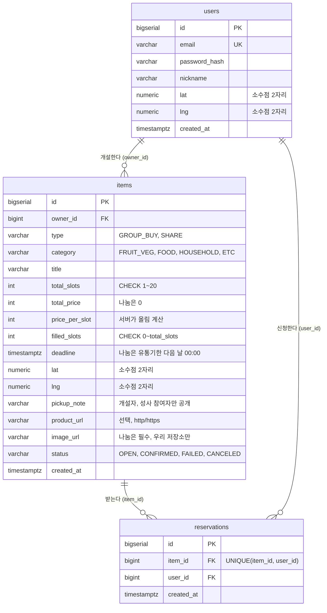

### 7.3 엔티티 속성 모델

#### `users`

| 속성 | 역할 | 타입 | 제약 |
| --- | --- | --- | --- |
| `id` | 회원 식별자. JWT의 `sub`에 들어간다. | `bigserial` | PK |
| `email` | 로그인 식별자. 소문자로 저장한다. | `varchar(255)` | not null, UNIQUE |
| `password_hash` | 비밀번호 bcrypt 해시. | `varchar(255)` | not null, 평문 저장 금지 |
| `nickname` | 화면에 보이는 이름. | `varchar(20)` | not null, 2~20자 |
| `lat` | 가입 위치 위도. 목록 조회와 글 위치의 기본값. | `numeric(4,2)` | not null, 서버가 반올림 |
| `lng` | 가입 위치 경도. | `numeric(5,2)` | not null, 서버가 반올림 |
| `created_at` | 가입 시각. | `timestamptz` | not null, default `now()` |

#### `items`

| 속성 | 역할 | 타입 | 제약 |
| --- | --- | --- | --- |
| `id` | 글 식별자. | `bigserial` | PK |
| `owner_id` | 개설자 `users.id`. | `bigint` | not null, FK |
| `type` | 글 유형. | `varchar(10)` | not null, CHECK in (`GROUP_BUY`, `SHARE`) |
| `category` | 상품 분류. 화면 필터는 없다. | `varchar(10)` | not null, default `ETC`, CHECK in (`FRUIT_VEG`, `FOOD`, `HOUSEHOLD`, `ETC`) |
| `title` | 제목. 검색 대상. | `varchar(50)` | not null |
| `total_slots` | 이웃에게 나눌 몫 수. 개설자 몫은 제외한다. | `int` | not null, CHECK 1~20 |
| `total_price` | 개설자가 입력한 총 가격. | `int` | not null, CHECK 0 이상 |
| `price_per_slot` | 서버가 올림 계산한 몫당 가격. | `int` | not null |
| `filled_slots` | 신청된 몫 수. 조건부 UPDATE의 대상. | `int` | not null, default 0, CHECK `0 <= filled_slots <= total_slots` |
| `deadline` | 같이사기는 모집 마감, 나눔은 유통기한 다음 날 00:00(KST). 이 시각부터 신청 불가. | `timestamptz` | not null |
| `lat`, `lng` | 글 위치. 기본은 개설자 위치. | `numeric(4,2)`, `numeric(5,2)` | not null, 서버가 반올림 |
| `pickup_note` | 만남 장소, 시간, 연락 방법. | `varchar(200)` | not null, 개설자와 성사 참여자에게만 응답 |
| `product_url` | 상품 링크. | `varchar(500)` | nullable, http·https만 |
| `image_url` | 사진 주소. | `varchar(500)` | nullable, 우리 저장소 주소만 |
| `status` | 결과 상태. | `varchar(10)` | not null, default `OPEN`, CHECK in (`OPEN`, `CONFIRMED`, `FAILED`, `CANCELED`) |
| `created_at` | 작성 시각. | `timestamptz` | not null, default `now()` |

테이블 수준 CHECK:

```sql
CHECK (type <> 'SHARE' OR (total_slots = 1 AND total_price = 0 AND image_url IS NOT NULL))
```

#### `reservations`

| 속성 | 역할 | 타입 | 제약 |
| --- | --- | --- | --- |
| `id` | 신청 식별자. | `bigserial` | PK |
| `item_id` | 신청한 글 `items.id`. | `bigint` | not null, FK |
| `user_id` | 신청자 `users.id`. | `bigint` | not null, FK |
| `created_at` | 신청 시각. | `timestamptz` | not null, default `now()` |

- `UNIQUE (item_id, user_id)`: 한 사람이 한 글에 한 번만 신청합니다.

#### 인덱스

| 인덱스 | 용도 |
| --- | --- |
| `items (status, deadline)` | 메인 목록 조회, 마감 임박 순 정렬, 무산 기록 문장 |
| `items (owner_id)` | 내 글 조회 |
| `reservations (user_id)` | 내 참여 조회 |
| `reservations (item_id, user_id)` UNIQUE | 중복 신청 방지, 글별 참여자 조회 |

### 7.4 관계 모델

| 주체 | 관계 | 대상 | 카디널리티 | 의미 |
| --- | --- | --- | --- | --- |
| `users` | 개설한다 | `items` | 1:N | 한 회원은 여러 글을 올릴 수 있다. |
| `users` | 신청한다 | `reservations` | 1:N | 한 회원은 여러 글에 몫을 신청할 수 있다. |
| `items` | 받는다 | `reservations` | 1:0..total_slots | 한 글은 최대 `total_slots`건의 신청을 받는다. |
| `users` ↔ `items` | 참여한다 | (`reservations` 경유) | N:M | 회원과 글의 참여 관계는 `reservations`가 연결한다. 같은 쌍은 한 번만 존재하고, 개설자 자신은 참여할 수 없다. |

### 7.5 설계 결정

- **같이사기와 나눔을 한 테이블에**: 나눔은 `total_slots` 1, `price_per_slot` 0인 같이사기입니다. 신청 로직이 같아 코드와 테이블이 늘지 않습니다.
- **나눔 입력과 컬럼의 대응**: 나눔 폼에는 제목, 유통기한, 만남 장소 메모, 사진만 있습니다. 유통기한은 다음 날 00:00 KST로 바꿔 `deadline`에 저장하고, `total_slots=1`, `total_price=0`, `price_per_slot=0`은 서버가 채웁니다. 클라이언트가 다른 값을 보내도 무시합니다.
- **category 컬럼**: 소재를 식재료에서 대용량 생필품까지 넓히는 비용이 컬럼 하나입니다. 화면에는 필터를 두지 않고 탭과 검색으로 찾게 합니다.
- **filled_slots 컬럼**: 신청 수를 매번 세지 않고 저장합니다. 같은 값이 두 곳(컬럼과 신청 기록)에 있는 비정규화지만, 동시 신청을 조건부 UPDATE 한 문장으로 막기 위한 선택이고 같은 트랜잭션에서 함께 바꿉니다.
- **마감 판단은 시각으로**: 신청 가능 여부는 `deadline > now()`로 판단하고, status는 결과(성사, 무산, 취소)만 기록합니다. 무산은 내 참여·내 글 조회 때 별도 트랜잭션의 멱등 UPDATE로 기록합니다(5.4).
- **total_price도 저장**: 몫당 가격은 올림이라 총 가격을 되살릴 수 없습니다. 화면에 총 가격을 함께 보여 주고 계산 근거를 남깁니다.
- **위치는 numeric**: 소수점 2자리 반올림이 정확히 유지되고, 저장된 값만 봐도 흐려 저장했다는 것이 드러납니다.
- **시각은 timestamptz**: 서버와 DB의 시간대가 달라도 같은 순간으로 비교됩니다. 화면에서만 한국 시간으로 보여 줍니다.
- **확장 시 바꿀 지점**: 한 사람이 여러 몫을 사거나 신청을 취소하려면 reservations에 quantity와 status를 추가하고 상태 규칙을 확장합니다. MVP는 "1인 1몫, 취소 없음"으로 단순하게 둡니다.

## 8. 에러 코드 기준

모든 에러는 같은 형식으로 응답합니다. 프론트는 `code`만 보고 안내 문구를 고릅니다. 입력 오류일 때만 `field`가 붙습니다.

```json
{ "code": "SLOTS_FULL", "message": "방금 몫이 모두 찼어요" }
```

```json
{ "code": "INVALID_INPUT", "message": "마감 시각은 지금 이후여야 해요", "field": "deadline" }
```

| code | HTTP | 발생 API | 의미 | 화면 문구 | 후속 동작 |
| --- | --- | --- | --- | --- | --- |
| `INVALID_INPUT` | 400 | 공통 | 형식, 범위, 유형별 규칙 위반(마감이 과거, 나눔인데 사진 없음, 링크 스킴, 저장소 밖 image_url 등) | `message` 그대로 | `field` 입력 아래에 표시 |
| `EMAIL_TAKEN` | 409 | A-01 | 이미 가입된 이메일 | 이미 가입된 이메일이에요 | 로그인 화면 링크 |
| `INVALID_CREDENTIALS` | 401 | A-02 | 이메일 또는 비밀번호 불일치 | 이메일 또는 비밀번호가 맞지 않아요 | 비밀번호 입력란 비우기 |
| `UNAUTHORIZED` | 401 | 인증 필요 API 전체 | 토큰이 없거나, 위조됐거나, 만료됨 | 다시 로그인해 주세요 | 토큰 삭제 후 로그인 화면 |
| `NOT_FOUND` | 404 | A-05, A-09 | 글이 없음 | 글을 찾을 수 없어요 | 목록으로 이동 |
| `OWN_ITEM` | 403 | A-05 | 내 글에 신청 | 내가 올린 글에는 신청할 수 없어요 | 신청 버튼 숨김 |
| `NOT_OWNER` | 403 | A-09 | 남의 글을 취소 | 내가 올린 글만 취소할 수 있어요 | 내 글 새로고침 |
| `ALREADY_JOINED` | 409 | A-05 | 이미 이 글에 신청함 | 이미 신청한 글이에요 | 내 참여로 이동 버튼 |
| `SLOTS_FULL` | 409 | A-05 | 몫이 다 찼거나 이미 성사됨 | 방금 몫이 모두 찼어요 | 목록 새로고침 |
| `NOT_OPEN` | 409 | A-09 | 이미 성사·무산·취소되어 취소할 수 없음 | 이미 끝난 글이라 취소할 수 없어요 | 내 글 새로고침 |
| `EXPIRED` | 410 | A-05 | 마감이 지났거나 무산·취소됨 | 마감되었거나 취소된 글이에요 | 목록 새로고침 |
| `FILE_TOO_LARGE` | 413 | A-07 | 500KB 초과 | 사진이 너무 커요 | 다시 줄여서 업로드 |
| `UNSUPPORTED_FILE` | 415 | A-07 | jpeg·png·webp가 아님 | jpg, png, webp만 올릴 수 있어요 | 사진 다시 선택 |
| `UPLOAD_FAILED` | 502 | A-07 | 외부 저장소 저장 실패 | 사진을 올리지 못했어요 | 재시도 버튼 |

HTTP 상태 코드 규칙: 400 입력 오류, 401 인증 실패, 403 권한 없음(내 글에 신청, 남의 글 취소), 404 대상 없음, 409 현재 상태와 충돌, 410 마감되어 더 이상 불가능, 413 파일이 너무 큼, 415 지원하지 않는 형식, 502 외부 저장소 오류.

## 9. E2E 흐름

### 9.1 시나리오 목록

| 번호 | 시나리오 | 시작 조건 | 핵심 DB 조회/상태 기준 | 성공 결과 |
| --- | --- | --- | --- | --- |
| 1 | 회원가입과 로그인 | 사용자가 웹에 접속한다. | `users.email` 중복 여부, `password_hash` 검증 | `users` row 생성, 토큰 발급 |
| 2 | 글 작성 | 로그인한 사용자가 + 버튼을 누른다. | 유형별 입력 규칙, 사진 업로드 결과 | `items` row 생성 |
| 3 | 메인 목록 조회 | 메인 진입, 탭·검색·정렬 변경 | `status = OPEN AND deadline > now()`, 거리, `type`, 제목 | 글 목록 반환 |
| 4 | 몫 신청 | 사용자가 신청 버튼을 누른다. | 조건부 UPDATE 영향 행 수, UNIQUE 위반 여부 | `filled_slots` 증가, `reservations` row 생성, 마지막 몫이면 `CONFIRMED` |
| 5 | 내 참여 / 내 글 조회 | 사용자가 내 활동을 연다. | 무산 기록 문장(별도 트랜잭션), `reservations.user_id`, `items.owner_id` | 신청한 글과 올린 글 반환 |
| 6 | 개설 취소 | 개설자가 내 글에서 취소를 누른다. | 조건부 UPDATE(`owner_id`, `status = OPEN`, 마감 전) | `status = CANCELED` |

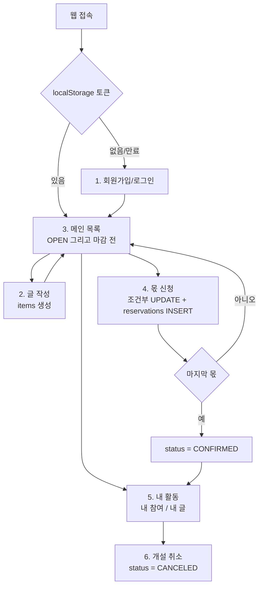

### 9.2 회원가입과 로그인

| 항목 | 내용 |
| --- | --- |
| 시작 액션 | 가입 폼(이메일, 비밀번호, 닉네임, 위치) 또는 로그인 폼(이메일, 비밀번호) 제출 |
| DB 조회/상태 분기 | 입력 형식, `users.email` 중복 여부, `password_hash` 검증 결과 |
| 생성/변경 필드 | 가입: `users.email`(소문자), `password_hash`, `nickname`, `lat`, `lng`(반올림), `created_at` 생성 |
| 성공 응답 | 가입 `201` 사용자 id / 로그인 `200` `access_token`, 사용자 정보 |
| 실패 코드 | `INVALID_INPUT`, `EMAIL_TAKEN`, `INVALID_CREDENTIALS` |

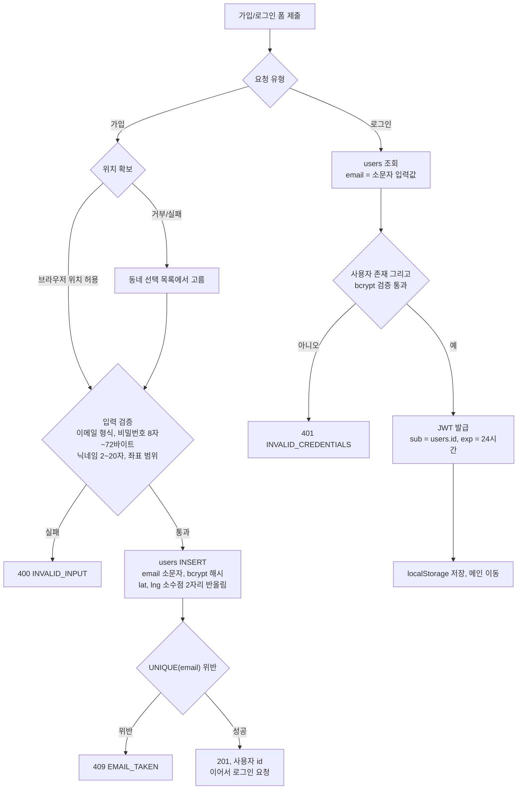

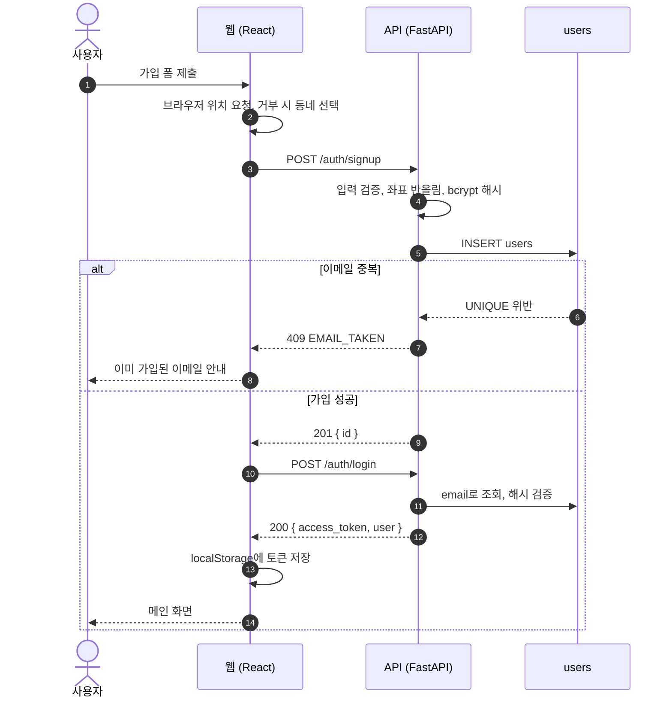

### 9.3 글 작성

| 항목 | 내용 |
| --- | --- |
| 시작 액션 | + 버튼으로 폼을 채우고 제출. 사진이 있으면 먼저 업로드한다. |
| DB 조회/상태 분기 | 유형별 입력 규칙(5.3), `image_url` 주소 출처, `product_url` 스킴 |
| 생성/변경 필드 | `items.owner_id = 토큰 sub`, `type`, `category`, `title`, `total_slots`, `total_price`, `price_per_slot = ceil(total_price / total_slots)`, `filled_slots = 0`, `deadline`, `lat`, `lng`(기본 내 위치, 반올림), `pickup_note`, `product_url`, `image_url`, `status = OPEN` |
| 성공 응답 | `201`, 작성된 글 |
| 실패 코드 | `UNAUTHORIZED`, `INVALID_INPUT`, `FILE_TOO_LARGE`, `UNSUPPORTED_FILE`, `UPLOAD_FAILED` |

> 사진 업로드와 나눔 분기는 나눔 묶음(Should)입니다. Must 단계에서는 같이사기 분기만 구현합니다.

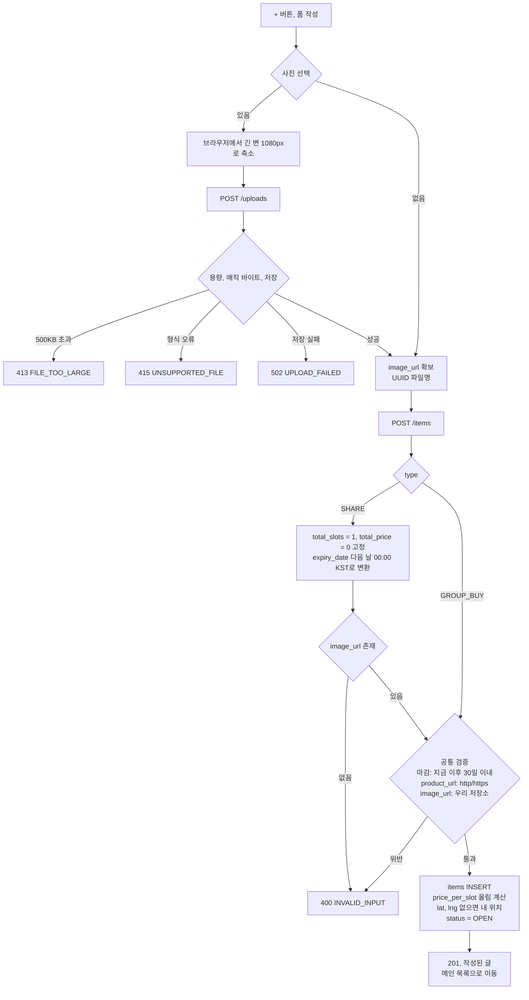

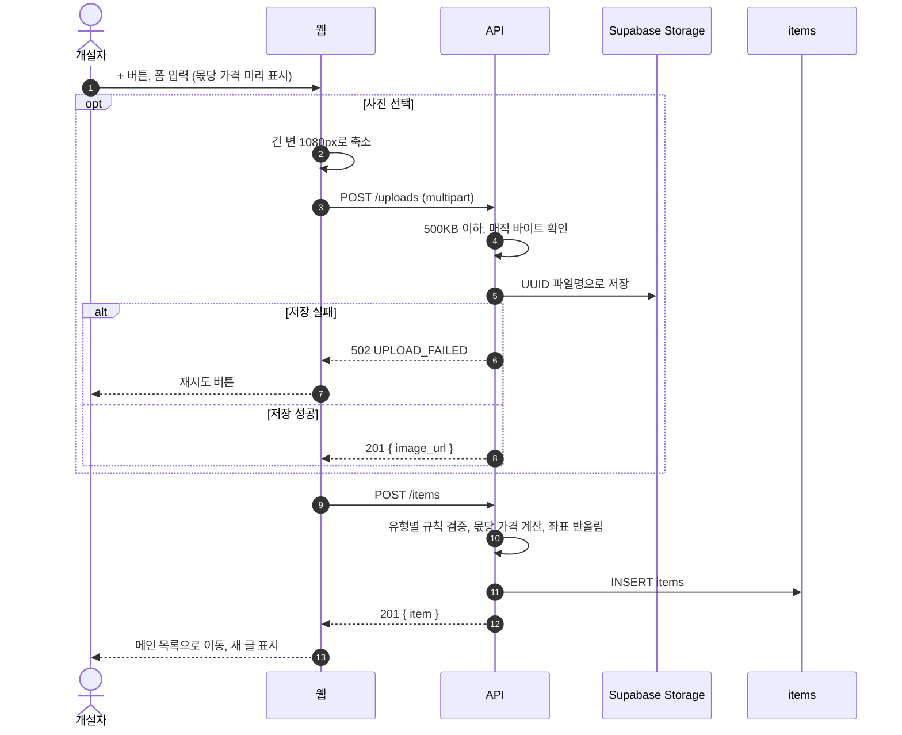

### 9.4 메인 목록 조회

| 항목 | 내용 |
| --- | --- |
| 시작 액션 | 메인 진입, 탭 전환, 검색어 입력, 정렬 전환 |
| DB 조회/상태 분기 | `type`, `status = OPEN AND deadline > now()`, 반경, 제목 부분 일치 |
| 생성/변경 필드 | 없음 (조회만 한다. 마감은 `deadline > now()`로 판단) |
| 성공 응답 | `200`, 글 목록 (`pickup_note` 제외). 비어 있으면 빈 배열 |
| 실패 코드 | `UNAUTHORIZED`, `INVALID_INPUT` |

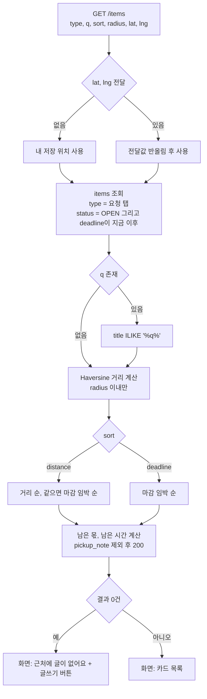

### 9.5 몫 신청

| 항목 | 내용 |
| --- | --- |
| 시작 액션 | 카드의 신청 버튼을 누르고 확인 창에서 확정 |
| DB 조회/상태 분기 | 조건부 UPDATE 영향 행 수, 0행일 때 재조회 결과, `reservations` UNIQUE 위반 여부 |
| 생성/변경 필드 | `items.filled_slots + 1`, 마지막 몫이면 `items.status = CONFIRMED` / `reservations.item_id`, `user_id = 토큰 sub`, `created_at` |
| 성공 응답 | `201`, 신청 결과, 남은 몫, 글 상태 |
| 실패 코드 | `UNAUTHORIZED`, `NOT_FOUND`, `OWN_ITEM`, `ALREADY_JOINED`, `SLOTS_FULL`, `EXPIRED` |

**처리 순서**

1. 트랜잭션을 시작하고 아래 한 문장을 실행한다. 무산 기록 문장은 실행하지 않는다(5.4). 몫 증가, 마지막 몫이면 성사 전환, 결과 읽기가 한 번에 일어난다.

   ```sql
   UPDATE items
   SET filled_slots = filled_slots + 1,
       status = CASE WHEN filled_slots + 1 = total_slots
                     THEN 'CONFIRMED' ELSE status END
   WHERE id = :id
     AND status = 'OPEN'
     AND deadline > now()
     AND filled_slots < total_slots
     AND owner_id <> :user_id
   RETURNING filled_slots, total_slots, status;
   ```

2. 영향 받은 행이 1이면 reservations에 한 건을 넣는다. 같은 사람이 다시 신청하면 UNIQUE 위반이 나고, 트랜잭션 전체를 되돌려 filled_slots 증가도 취소한 뒤 409 `ALREADY_JOINED`로 답한다.
3. 영향 받은 행이 0이면 롤백하고 원인을 아래 순서로 가린다. 앞의 조건이 맞으면 거기서 멈춘다.
   1. 글이 없다 → 404 `NOT_FOUND`
   2. 내 신청 기록이 이미 있다 → 409 `ALREADY_JOINED`
   3. 내 글이다 → 403 `OWN_ITEM`
   4. 상태가 FAILED나 CANCELED이거나 마감이 지났다 → 410 `EXPIRED`
   5. 그 밖(몫이 찼거나 이미 성사) → 409 `SLOTS_FULL`

   "이미 신청함"을 앞에 두는 이유: 같은 계정이 마지막 몫에 동시에 두 번 신청하면 두 번째 요청은 UPDATE가 0행이 된다. 판정 SELECT는 새 문장이라 먼저 커밋된 신청 기록이 보이므로(READ COMMITTED), 이 경우에도 `ALREADY_JOINED`가 나온다.
4. 커밋한다.

**왜 한 명만 성공하나**: PostgreSQL은 같은 행을 UPDATE하려는 트랜잭션을 줄 세웁니다. 먼저 들어온 트랜잭션이 커밋하면, 기다리던 트랜잭션은 바뀐 행으로 `WHERE` 조건을 다시 평가합니다. 이때 `filled_slots < total_slots`가 거짓이 되어 0행이 됩니다. 별도의 행 락이나 `SELECT ... FOR UPDATE`가 필요 없습니다. 같은 원리로 신청과 개설 취소가 동시에 들어와도 한쪽만 통과합니다.

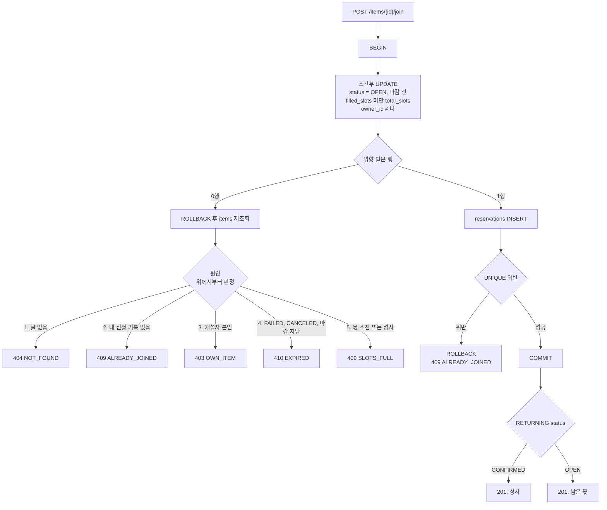

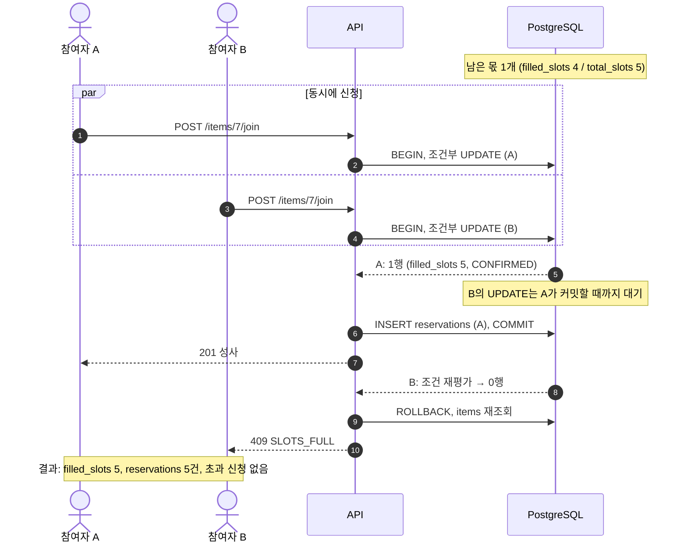

### 9.6 내 참여 / 내 글 조회

| 항목 | 내용 |
| --- | --- |
| 시작 액션 | 상단 메뉴에서 내 활동을 연다. "내 참여", "내 글" 두 탭. |
| DB 조회/상태 분기 | 무산 기록 문장을 별도 트랜잭션으로 먼저 실행(5.4)한 뒤, 내 참여: `reservations.user_id = 나` / 내 글: `items.owner_id = 나` |
| 생성/변경 필드 | 마감 지난 OPEN 글의 `status = FAILED` (멱등) |
| 성공 응답 | 내 참여: 상태, 개설자 닉네임, 성사된 건에만 `pickup_note` / 내 글: 상태, 몫 진행, `pickup_note`, 참여자 닉네임 목록 |
| 실패 코드 | `UNAUTHORIZED` |

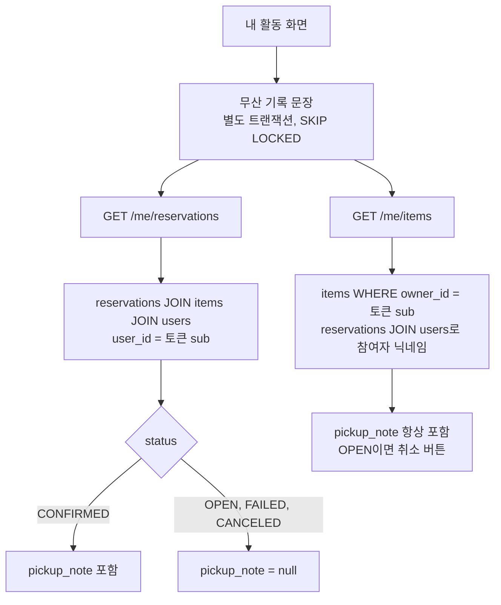

### 9.7 개설 취소

| 항목 | 내용 |
| --- | --- |
| 시작 액션 | 개설자가 내 글 탭에서 모집 중인 글의 취소 버튼을 누른다. |
| DB 조회/상태 분기 | 조건부 UPDATE 영향 행 수, 0행이면 재조회. 무산 기록 문장은 실행하지 않는다 |
| 생성/변경 필드 | `items.status = CANCELED` |
| 성공 응답 | `200`, 취소된 글 |
| 실패 코드 | `UNAUTHORIZED`, `NOT_FOUND`, `NOT_OWNER`, `NOT_OPEN` |

```sql
UPDATE items SET status = 'CANCELED'
WHERE id = :id
  AND owner_id = :user_id
  AND status = 'OPEN'
  AND deadline > now()
RETURNING *;
```

- 0행이면 재조회해서 글이 없으면 404 `NOT_FOUND`, 내 글이 아니면 403 `NOT_OWNER`, 그 밖에는 409 `NOT_OPEN`이다. 마감이 지났지만 아직 OPEN으로 남은 글도 조건의 `deadline > now()`에 걸려 409 `NOT_OPEN`이 된다.
- 이미 신청한 참여자에게는 내 참여 화면에서 "취소"로 보인다. 알림은 보내지 않는다.

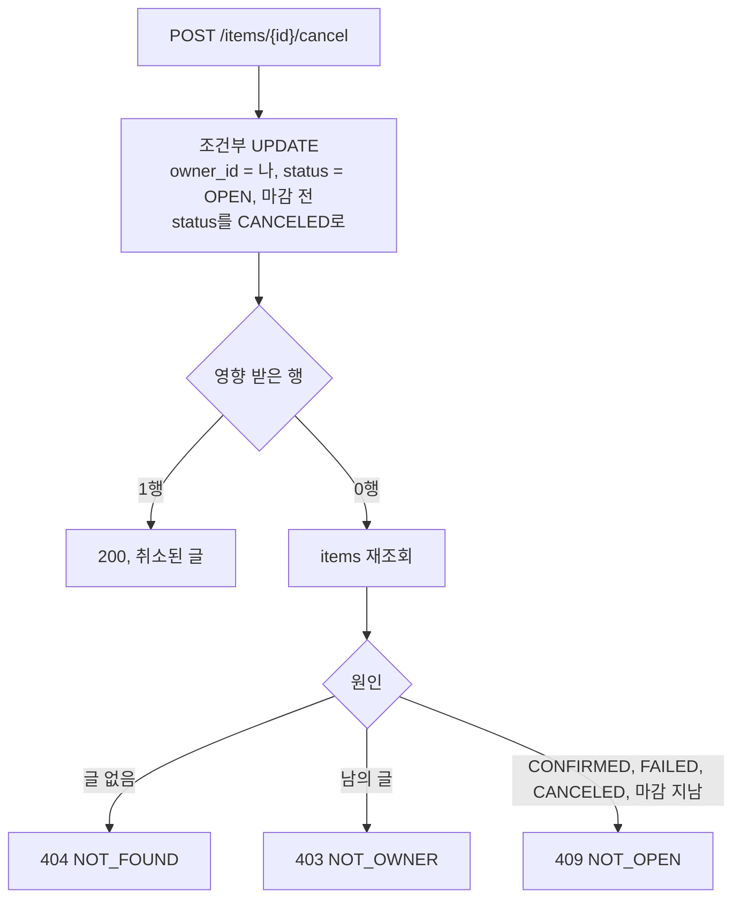

## 10. API 계약

### 10.1 공통 규칙

| 항목 | 계약 |
| --- | --- |
| 형식 | REST + JSON. 사진 업로드만 `multipart/form-data` |
| 인증 헤더 | 인증 필요 API는 `Authorization: Bearer <access_token>` |
| 사용자 결정 | 클라이언트는 `owner_id`, `user_id`를 보내지 않는다. 서버가 토큰의 `sub`를 쓴다. |
| 시각 | 요청과 응답 모두 오프셋이 붙은 ISO 8601(`2026-10-13T18:00:00+09:00`). 서버가 `created_at`을 만든다. |
| 좌표 | 클라이언트가 정밀 좌표를 보내도 서버가 소수점 2자리로 반올림해 저장한다. |
| 무산 기록 | A-06, A-08만 처리 전에 무산 기록 문장을 별도 트랜잭션으로 실행한다(5.4). 응답의 `status`는 저장값이 OPEN이어도 마감이 지났으면 `FAILED`로 내보낸다. |
| 에러 | 8장의 공통 형식. 인증 필요 API는 모두 `UNAUTHORIZED`가 날 수 있다. |
| CORS | 프론트 배포 주소와 localhost만 허용한다. |

### 10.2 API 목록

9개로 가입부터 몫 신청, 내 참여와 내 글 확인까지 한 흐름이 끝납니다.

| ID | 메서드, 경로 | 목적 | 인증 | 성공 | 주요 에러 |
| --- | --- | --- | --- | --- | --- |
| A-01 | `POST /auth/signup` | 회원가입 | 불필요 | 201 | 400, 409 `EMAIL_TAKEN` |
| A-02 | `POST /auth/login` | 로그인, 토큰 발급 | 불필요 | 200 | 401 `INVALID_CREDENTIALS` |
| A-03 | `GET /items` | 메인 목록 조회 | 필요 | 200 | 400, 401 |
| A-04 | `POST /items` | 글 작성 | 필요 | 201 | 400, 401 |
| A-05 | `POST /items/{id}/join` | 몫 신청 | 필요 | 201 | 403, 404, 409, 410 |
| A-06 | `GET /me/reservations` | 내 참여 | 필요 | 200 | 401 |
| A-07 | `POST /uploads` | 사진 업로드 | 필요 | 201 | 413, 415, 502 |
| A-08 | `GET /me/items` | 내 글과 참여자 | 필요 | 200 | 401 |
| A-09 | `POST /items/{id}/cancel` | 개설 취소 | 필요 | 200 | 403, 404, 409 |

### 10.3 A-01 `POST /auth/signup`

요청:

```json
{
  "email": "user@example.com",
  "password": "password1234",
  "nickname": "망원동자취생",
  "lat": 37.5563,
  "lng": 126.9019
}
```

응답 `201`:

```json
{ "id": 12 }
```

### 10.4 A-02 `POST /auth/login`

요청:

```json
{ "email": "user@example.com", "password": "password1234" }
```

응답 `200`:

```json
{
  "access_token": "eyJhbGciOi...",
  "token_type": "bearer",
  "expires_in": 86400,
  "user": { "id": 12, "nickname": "망원동자취생", "lat": 37.56, "lng": 126.90 }
}
```

### 10.5 A-03 `GET /items`

| 쿼리 | 필수 | 값 | 기본값 |
| --- | --- | --- | --- |
| `type` | 예 | `GROUP_BUY`, `SHARE` | |
| `sort` | 아니오 | `distance`, `deadline` | `distance` |
| `radius` | 아니오 | `3`, `5` (km) | `5` |
| `q` | 아니오 | 제목 검색어, 50자 이하 | |
| `lat`, `lng` | 아니오 | 기준 좌표 | 내 저장 위치 |

응답 `200` (OPEN이고 마감 전인 글만):

```json
{
  "items": [
    {
      "id": 7,
      "type": "GROUP_BUY",
      "category": "FRUIT_VEG",
      "title": "샤인머스켓 2kg 나눠요",
      "owner_nickname": "망원동자취생",
      "total_slots": 5,
      "filled_slots": 3,
      "remaining_slots": 2,
      "total_price": 25000,
      "price_per_slot": 5000,
      "deadline": "2026-10-13T18:00:00+09:00",
      "distance_km": 1.2,
      "status": "OPEN",
      "is_mine": false,
      "is_joined": false,
      "image_url": "https://xxxx.supabase.co/storage/v1/object/public/images/3f2a....webp",
      "product_url": "https://example.com/product/123"
    }
  ]
}
```

- `pickup_note`는 넣지 않는다.
- `is_mine`이면 신청 버튼을 숨기고, `is_joined`이면 "신청함"으로 비활성화한다.

### 10.6 A-04 `POST /items`

같이사기 요청:

```json
{
  "type": "GROUP_BUY",
  "category": "FRUIT_VEG",
  "title": "샤인머스켓 2kg 나눠요",
  "total_slots": 5,
  "total_price": 25000,
  "deadline": "2026-10-13T18:00:00+09:00",
  "pickup_note": "망원역 2번 출구, 10/13 19시, 오픈채팅 https://open.kakao.com/...",
  "product_url": "https://example.com/product/123",
  "image_url": null
}
```

나눔 요청 (나눔 묶음. `deadline` 대신 `expiry_date`. `total_slots`, `total_price`는 보내도 서버가 1, 0으로 정한다):

```json
{
  "type": "SHARE",
  "title": "두부 반 모, 내일까지",
  "expiry_date": "2026-10-13",
  "pickup_note": "망원동 ○○빌라 앞, 오늘 21시 이후, 오픈채팅 https://open.kakao.com/...",
  "image_url": "https://xxxx.supabase.co/storage/v1/object/public/images/9b1c....webp"
}
```

- `lat`, `lng`는 선택이고, 없으면 내 저장 위치를 쓴다.

응답 `201`: 작성된 글 전체(A-03 항목 형식 + `pickup_note`). 나눔은 `deadline`이 유통기한 다음 날 00:00인 `2026-10-14T00:00:00+09:00`으로 채워진다.

### 10.7 A-05 `POST /items/{id}/join`

요청 본문 없음.

응답 `201`:

```json
{
  "reservation_id": 31,
  "item_id": 7,
  "filled_slots": 5,
  "total_slots": 5,
  "remaining_slots": 0,
  "status": "CONFIRMED"
}
```

실패: `NOT_FOUND`(404), `OWN_ITEM`(403), `ALREADY_JOINED`(409), `SLOTS_FULL`(409), `EXPIRED`(410)

### 10.8 A-06 `GET /me/reservations`

응답 `200`:

```json
{
  "reservations": [
    {
      "reservation_id": 31,
      "joined_at": "2026-10-12T15:02:11+09:00",
      "item": {
        "id": 7,
        "type": "GROUP_BUY",
        "title": "샤인머스켓 2kg 나눠요",
        "owner_nickname": "망원동자취생",
        "price_per_slot": 5000,
        "deadline": "2026-10-13T18:00:00+09:00",
        "status": "CONFIRMED",
        "pickup_note": "망원역 2번 출구, 10/13 19시, 오픈채팅 https://open.kakao.com/..."
      }
    }
  ]
}
```

- `pickup_note`는 `status`가 `CONFIRMED`일 때만 넣고, 나머지는 `null`이다.

### 10.9 A-07 `POST /uploads`

요청: `multipart/form-data`, 필드 `file` 1개

응답 `201`:

```json
{ "image_url": "https://xxxx.supabase.co/storage/v1/object/public/images/3f2a....webp" }
```

실패: `FILE_TOO_LARGE`(413), `UNSUPPORTED_FILE`(415), `UPLOAD_FAILED`(502)

### 10.10 A-08 `GET /me/items`

응답 `200`:

```json
{
  "items": [
    {
      "id": 7,
      "type": "GROUP_BUY",
      "title": "샤인머스켓 2kg 나눠요",
      "filled_slots": 5,
      "total_slots": 5,
      "deadline": "2026-10-13T18:00:00+09:00",
      "status": "CONFIRMED",
      "pickup_note": "망원역 2번 출구, 10/13 19시, 오픈채팅 https://open.kakao.com/...",
      "participants": [
        { "nickname": "합정동라면왕", "joined_at": "2026-10-12T14:10:00+09:00" }
      ]
    }
  ]
}
```

### 10.11 A-09 `POST /items/{id}/cancel`

요청 본문 없음. 응답 `200`: 취소된 글(A-08 항목 형식, `status: "CANCELED"`).

실패: `NOT_FOUND`(404), `NOT_OWNER`(403), `NOT_OPEN`(409)

## 11. 화면 요구사항

화면은 4개이고, 모바일 웹(폭 360~430px)을 기준으로 만듭니다. PC에서는 같은 화면이 가운데 정렬됩니다.

| 화면 | 구성 | 연결 API |
| --- | --- | --- |
| 로그인, 가입 | 이메일, 비밀번호 폼. 가입 시 닉네임과 위치. 위치는 브라우저 위치 허용을 먼저 요청하고, 거부하거나 실패하면 동네 선택 목록(약 20곳)으로 넘어간다. 가입에 성공하면 자동으로 로그인하고 메인으로 이동 | A-01, A-02 |
| 메인 | 상단 검색창과 탭 2개(같이사기, 같이 마감하기. 나눔 묶음을 빼면 같이 마감하기 탭을 숨김), 정렬 전환(가까운 순, 마감 임박 순). 카드마다 제목, 개설자 닉네임, 몫 진행(3/5), 몫당 가격(올림)과 총액, 거리, 마감 카운트다운, 신청 버튼(내 글이면 숨김, 이미 신청했으면 비활성화). 같이 마감하기 카드는 사진을 크게, 같이사기 카드는 상품 링크가 있으면 상품 보기 버튼. 결과가 없으면 "근처에 글이 없어요"와 글쓰기 버튼. 오른쪽 아래 + 버튼, 상단 메뉴에 내 활동 | A-03, A-05 |
| 글 작성 | + 버튼으로 열고 현재 탭의 유형이 선택된다. 같이사기는 제목, 총 가격, 몫 수("몫당 3,334원(올림) · 총 10,000원"처럼 바로 표시, "내 몫은 빼고 입력" 안내), 마감 시각, 만남 장소 메모(예시 문구 제공), 상품 링크(선택), "정산은 당사자끼리 하며 서비스는 관여하지 않아요" 안내. 나눔 묶음이 완성되면 같이사기 사진(선택)과 같이 마감하기 폼(제목, 유통기한 날짜, 만남 장소 메모, 사진 필수·카메라 촬영 가능)을 추가. 위치는 내 위치가 기본 | A-04, (나눔 묶음) A-07 |
| 내 활동 | 두 탭. "내 참여"는 내가 신청한 목록과 상태, 성사된 건의 개설자 닉네임과 만남 장소 메모. "내 글"은 내가 올린 글의 상태, 몫 진행, 만남 장소 메모, 참여자 닉네임과 모집 중 글의 취소 버튼 | A-06, A-08, A-09 |

**공통 규칙**

- `UNAUTHORIZED`를 받으면 토큰을 지우고 로그인 화면으로 보냅니다.
- 신청 전 "신청 후에는 취소할 수 없어요" 확인 창을 띄우고, 확정하는 순간 버튼을 비활성화해 더블클릭을 막습니다.
- 신청 실패는 에러 code별 문구(8장 표)를 보여 주고 목록을 새로고침합니다.
- 마감 카운트다운이 0이 되면 카드의 신청 버튼을 비활성화합니다. 서버도 같은 기준으로 막습니다.
- 나눔의 마감은 "10/13까지"처럼 유통기한 날짜로 표시합니다. 저장된 `deadline`(다음 날 00:00)을 그대로 보여 주지 않습니다.
- 사진은 업로드 전에 브라우저에서 긴 변 1080px로 줄이고, 상품 링크는 http, https 주소만 받으며 새 탭(`rel="noopener noreferrer"`)으로 엽니다.

## 12. 비기능 요구사항

데모에서 설명할 수 있는 것만 약속합니다. 동시성, 인증, 개인정보가 핵심이고 성능과 확장은 설명으로 대체합니다.

| 항목 | 요구사항 | 방법 |
| --- | --- | --- |
| 보안 | 비밀번호를 평문으로 저장하지 않는다 | bcrypt 해시 |
| 인증 | 로그인 후에만 조회, 작성, 신청, 업로드가 가능하다 | JWT(Bearer), 만료 24시간 |
| 동시성 | 남은 몫보다 많이 신청받지 않는다. 같은 사람의 중복 신청도 막는다 | 조건부 UPDATE 한 문장 + UNIQUE (item_id, user_id) + CHECK (filled_slots ≤ total_slots) |
| 마감 처리 | 마감이 지난 글은 신청할 수 없다 | 신청 가능 여부는 항상 deadline > now()로 판단. 무산 기록은 내 참여·내 글 조회 때 별도 트랜잭션의 멱등 UPDATE로 남기고 스케줄러는 없다 |
| 시간대 | 마감 시각이 어긋나지 않는다 | timestamptz로 저장, 응답에 오프셋 포함, 화면은 KST |
| 개인정보 | 정확한 위치가 드러날 위험을 줄인다 | 좌표는 서버가 소수점 2자리(약 1km 격자)로 반올림해 저장. 위험을 줄일 뿐 없애지는 못한다. 만남 장소는 성사된 참여자와 개설자에게만 노출 |
| 입력 보호 | 이상한 파일과 링크를 막는다 | 이미지는 jpeg, png, webp만, 500KB 이하, 글당 1장, 매직 바이트 검사, UUID 파일명. 글의 image_url은 우리 저장소 주소만 허용. product_url은 http, https만 허용 |
| 비용 | 무료 플랜 범위 안에서 운영하는 것이 목표다(한도와 정책은 바뀔 수 있다) | 무료 플랜만 사용. 지도 SDK, 메일·문자 발송, 유료 외부 API를 쓰지 않고 결제 수단을 연결하지 않는다 |
| 가용성 | 무료 플랜의 제약을 알고 쓴다 | 서버는 15분 유휴 후 꺼지고 DB는 일주일 미사용 시 일시정지된다. 발표 전에 깨워 둔다 |
| 성능 | 목록 조회 1초 이내 (시드 데이터 1,000건 기준) | (status, deadline) 인덱스. 검색은 제목 부분 일치 |
| 거리 계산 | 반경 조회 | Haversine 공식. 확장 시 PostGIS 공간 인덱스로 전환 |
| 배포 | 데모 URL로 접속 가능하다 | Render와 Supabase 무료 플랜, CORS와 풀러 연결 설정 |
| 에러 코드 | 문서의 반환 조건과 실제 응답이 일치한다 | 8장의 에러 코드마다 반환 조건을 확인하는 pytest를 하나씩 둔다 |

## 13. 제외 범위, 리스크, 일정, 완료 기준

**제외 범위**: 결제와 정산, 몫당 가격의 잔액 분배, 배달 공동주문, 상품 링크 자동 채우기, 카테고리 필터, 리뷰와 신뢰점수, 푸시 알림, 앱 내 채팅, 지도 SDK, 참여자의 신청 취소, 1인 여러 몫, 로그인 시도 제한, 리프레시 토큰, 버려진 사진 정리, 마감 배치 스케줄러, PostGIS.

**리스크와 대응**

| 리스크 | 대응 |
| --- | --- |
| 동시 신청 테스트가 뒤로 밀린다 | 8시간째에 동시 신청 스크립트(10개 동시 요청)를 먼저 통과시킨다. 조건부 UPDATE 한 문장이면 행 락은 쓰지 않아도 된다 |
| 배포에서 막힌다(CORS, DB 연결, 슬립) | 12시간째에 첫 배포를 해 보고, 18시간째까지 로컬 데모 영상을 먼저 확보한다. 풀러 연결과 prepared statement 설정을 처음부터 적용한다 |
| 이미지 업로드가 길어진다(2~3시간) | 시드 데이터에 사진을 미리 넣어 데모하고, 업로드는 남는 시간만큼 붙인다 |
| 무료 서버가 데모 중에 잠들어 있다 | 발표 10분 전에 접속해 깨우고 데모에 쓸 요청을 한 번씩 보낸다 |
| 무료 DB가 일시정지되어 있다 | 발표 전날 대시보드에서 상태를 확인하고 깨운다 |
| 위치 입력이 번거롭다 | 위치 거부 시 동네 선택 목록으로 넘어가고, 시드 데이터에 같은 동네 글을 넣는다 |
| 소분 판매가 식품 위생 문제로 지적받는다 | 개인 간 실비 분담으로 한정하고 결제는 넣지 않는다고 발표에서 먼저 말한다. 이것만으로 법적·위생상 문제가 해소되지는 않으므로, 실제 운영 전 취급 품목과 관련 규정을 별도로 검토한다고 함께 말한다 |
| 나눔, 검색, 이미지를 얹다가 핵심이 흔들린다 | Must 7개와 동시 신청 테스트를 끝낸 뒤에만 시작한다. 막히면 해당 기능만 잘라낸다. 나눔 묶음(업로드 + 나눔 탭)은 둘 다 되거나 통째로 빼고, 빼면 두 번째 탭을 숨긴다 |

**일정 (24시간)**

| 시간 | 작업 | 산출물 |
| --- | --- | --- |
| 0–3h | 스키마(제약 포함, Alembic), 프로젝트 세팅, 풀러 연결, CORS, 가입·로그인 | A-01, A-02 |
| 3–8h | 글 작성·조회, 몫 신청과 성사 판정, 무산 기록 문장, 내 참여·내 글·취소 | A-03 ~ A-06, A-08, A-09 |
| 8–9h | 동시 신청 스크립트(asyncio + httpx, 1몫 글에 요청 10개, 같은 계정 동시 2건) 통과, 에러 코드별 테스트 확인 | 1건 201, 9건 409 `SLOTS_FULL`, 같은 계정은 `ALREADY_JOINED` |
| 9–14h | 모바일 웹 화면(탭, + 버튼, 작성 폼, 내 활동). 12시간째 첫 배포와 CORS 확인 | 화면 4개, 첫 배포 |
| 14–16h | 시드 데이터(사진 포함), QA 표 전체 점검 | Must 완료 |
| 16–18.5h | 나눔 묶음 ①: 사진 업로드(Storage 버킷, 매직 바이트, 주소 형식 검증) | A-07, F-09 |
| 18.5–19.5h | 나눔 묶음 ②: 나눔 작성 폼과 같이 마감하기 탭. 19.5h까지 ①②가 다 안 되면 묶음 전체를 빼고 탭을 숨긴다 | F-07 |
| 19.5–20h | 검색 | F-08 |
| 20–23h | 배포 마무리, 발표 대본, 리허설(스크립트 시연 포함) | 데모 URL, 10분 대본 |
| 23–24h | 버퍼, 서버와 DB 깨우기 점검 | |

**완료 기준 (Definition of Done)**

Must (이것만 되면 데모가 성립)

- [ ] 신규 계정으로 가입하고 로그인할 수 있다. 위치 권한을 거부해도 동네 선택으로 가입된다.
- [ ] 같이사기 글을 올리면 몫당 가격이 올림 계산되고, 목록에서 몫 진행과 마감 카운트다운이 보인다.
- [ ] 마감이 지난 글은 신청할 수 없고(410 `EXPIRED`) 목록에서 사라진다.
- [ ] 마지막 한 몫에 요청 10개를 동시에 보내면 1건만 성공(201)하고 9건은 409 `SLOTS_FULL`이며, 글이 성사로 바뀌고 `filled_slots`와 `reservations` 건수가 같다.
- [ ] 같은 계정의 두 번째 신청은 409 `ALREADY_JOINED`, 내 글 신청은 403 `OWN_ITEM`이다.
- [ ] 같은 계정이 마지막 한 몫에 동시에 두 번 신청하면 1건은 201, 1건은 409 `ALREADY_JOINED`다.
- [ ] 8장의 에러 코드마다 반환 조건 테스트가 통과한다(나눔 묶음 코드는 묶음을 넣을 때).
- [ ] 내 참여에서 성사된 글의 만남 장소 메모가 보이고, 성사 전에는 개설자 외 어느 응답에도 `pickup_note`가 없다.
- [ ] 내 글에서 참여자 닉네임이 보이고, 모집 중 글을 취소할 수 있다.
- [ ] 저장된 위치는 소수점 2자리로 반올림되어 있다.
- [ ] 배포된 URL에서 모바일 화면으로 Must 시나리오가 끊김 없이 돈다. 발표 전에 서버를 깨워 둔다.

Should (시간이 남으면)

- [ ] (나눔 묶음) 사진을 직접 올려 나눔 글(1몫, 0원)을 작성하고, 같이 마감하기 탭에서 신청 즉시 성사로 바뀐다. 마감은 유통기한 다음 날 00:00부터 막힌다.
- [ ] 검색창에 품목을 입력하면 현재 탭의 글만 걸러진다.
- [ ] (나눔 묶음) 사진 500KB 초과는 413, 허용되지 않은 형식은 415로 거절된다.
- [ ] 반경 3km, 5km 필터가 동작한다.

**QA 점검표** (14–16h에 한 번에 확인)

| 시나리오 | 기대 결과 |
| --- | --- |
| 같은 계정이 같은 글에 두 번 신청 | 두 번째는 409 `ALREADY_JOINED`, filled_slots는 1만 증가 |
| 같은 계정이 마지막 1몫에 동시에 2건 신청 | 1건 201, 1건 409 `ALREADY_JOINED`(`SLOTS_FULL` 아님) |
| 마지막 1몫에 10명이 동시에 신청 | 1건 201, 9건 409 `SLOTS_FULL`, 글은 CONFIRMED |
| 마감 직후 신청 | 410 `EXPIRED`, filled_slots 변화 없음 |
| 내 글에 신청 | 403 `OWN_ITEM` |
| 나눔 1개에 신청 | 즉시 CONFIRMED |
| 나눔을 유통기한 10/13로 작성 | deadline이 10/14 00:00 KST로 저장. 10/13 23:59:30에는 신청되고 10/14 00:00부터 410, 화면에는 "10/13까지" |
| 검색어 입력 | 현재 탭의 제목에 포함된 글만 보임 |
| 위치 저장값 확인 | DB의 lat, lng가 소수점 2자리 |
| 이미지 500KB 초과 업로드 | 413 `FILE_TOO_LARGE` |
| 이미지 확장자만 .jpg로 바꾼 다른 파일 | 415 `UNSUPPORTED_FILE` |
| 마감 지난 OPEN 글 | 목록에서 사라짐. 내 참여·내 글 조회 후 FAILED로 기록되고, 다시 조회해도 같은 결과 |
| 사진 주소를 다른 도메인이나 다른 버킷으로 작성 | 400 `INVALID_INPUT` |
| 개설자가 취소한 글에 신청 | 410 `EXPIRED` |
| 성사된 글을 취소 시도 | 409 `NOT_OPEN` |
| 남의 글을 취소 시도 | 403 `NOT_OWNER` |
| 마감이 지났지만 아직 OPEN으로 남은 글을 취소 시도 | 409 `NOT_OPEN` (조건부 UPDATE의 `deadline > now()`로 판단) |
| 로그인 없이 API 호출 | 401 `UNAUTHORIZED` |
| 신청 버튼 더블클릭 | 요청 1회, 중복 에러 문구가 뜨지 않음 |
| 위치 권한 거부 | 동네 선택 목록으로 이동 |
| 성사 전 pickup_note | 목록, 내 참여 어디에도 없음(내 글에서 개설자에게만 보임) |

## 14. 왜 이렇게 설계했나: 예상 질문과 답변

발표에서는 코드를 읽지 않고 "왜 이렇게 했는지"를 말합니다. 질문마다 선택, 이유, 감수한 대가를 한 번에 답할 수 있게 정리했습니다.

| 예상 질문 | 답변 |
| --- | --- |
| 같이는 정확히 뭘 하는 서비스인가요? | 자취생이 혼자 쓰기엔 많은 물건을 이웃과 같이 사서 몫으로 나눕니다. 이미 남은 건 몫 1개짜리 나눔으로 올립니다. 둘은 같은 구조의 다른 설정입니다. |
| 왜 테이블이 3개뿐인가요? | 같이사기와 나눔을 같은 items로 두고 type으로 구분했습니다. 나눔은 몫이 1개인 같이사기입니다. 테이블이 늘면 기능마다 조인과 코드가 늘어 24시간 안에 끝나지 않습니다. |
| 왜 식재료만이 아니고 생필품까지인가요? | 몫으로 나눌 수 있으면 같은 구조가 그대로 돕니다. category 컬럼 하나로 소재를 넓혔습니다. 배달 공동주문은 금액 합산과 결제가 필요해 로드맵으로 뒀습니다. |
| 남은 몫을 왜 컬럼으로 저장하나요? 신청 수를 세면 되지 않나요? | 신청 건수를 세는 방식은 동시 요청에서 둘 다 "1자리 남음"으로 읽을 수 있습니다. filled_slots를 조건부 UPDATE 한 문장으로 올리면 DB가 같은 행의 수정을 줄 세우고, 뒤에 온 요청은 조건을 다시 확인해 탈락합니다. 대신 컬럼과 신청 기록이 어긋나지 않도록 같은 트랜잭션에서 함께 바꿉니다. |
| 마감 처리를 왜 스케줄러로 안 했나요? | 마감을 상태로만 관리하면 배치가 늦을 때 마감된 글에 신청이 들어옵니다. 그래서 신청 가능 여부는 항상 deadline을 현재 시각과 비교해 판단합니다. 무산(FAILED) 기록은 내 참여·내 글 조회 때 "마감 지난 OPEN 글"을 한 번에 바꾸는 멱등 문장으로 남기고, 기록이 늦어도 동작은 틀리지 않습니다. 규모가 커지면 배치를 추가합니다. |
| 무산은 누가 언제 기록하나요? 동시 신청과 부딪히지 않나요? | 무산 상태가 화면에 보이는 내 참여와 내 글 요청이 시작될 때, 별도의 짧은 트랜잭션에서 UPDATE 한 문장으로 기록합니다. 여러 행을 바꾸는 문장이라 신청 경로에는 넣지 않았고, `SKIP LOCKED`로 다른 요청이 잡은 행은 건너뛰어 대기나 교착이 생기지 않습니다. 기록이 늦어도 신청 가능 여부는 deadline으로 판단하므로 결과는 틀리지 않습니다. |
| 중복 신청은 어디서 막나요? | 앱 코드의 검사는 동시에 두 번 눌리면 뚫립니다. UNIQUE (item_id, user_id) 제약이 DB에서 마지막으로 막고, 그때 같은 트랜잭션의 몫 증가도 함께 되돌아갑니다. 같은 계정이 마지막 몫에 동시에 두 번 신청하는 경우에도, 실패 원인을 판정할 때 신청 기록을 먼저 확인해 "이미 신청함"으로 안내합니다. |
| 왜 참여자의 신청 취소가 없나요? | 확정된 몫을 취소하면 "성사였던 글이 다시 모집 중이 되는가"라는 상태 전이, 재모집, 신뢰 문제가 따라옵니다. 24시간에서는 신청을 약속으로 보고, 신청 전에 확인 창을 띄우며 개설자 취소만 두었습니다. 확장할 때는 reservations에 status를 추가하고 상태 규칙을 늘립니다. |
| 개설자는 몫을 가져가나요? 만나는 건 어떻게 하나요? | 개설자는 몫을 가져가지 않고 total_slots는 이웃에게 나눌 몫입니다. 만남은 앱 채팅 없이, 개설자가 적은 장소·시간·연락 방법 메모를 성사된 참여자에게만 열어 해결합니다. 개설자는 내 글 화면에서 참여자 닉네임을 봅니다. |
| 위치 정보는 안전한가요? | 좌표를 서버가 소수점 2자리(약 1km 격자)로 반올림해 저장해서 정확한 위치가 드러날 위험을 줄였습니다. 다만 없애지는 못합니다. 인구가 적은 곳에서는 격자 하나에 집이 몇 채뿐일 수 있습니다. 정확한 만남 장소는 개설자와 성사된 참여자에게만 보입니다. 대신 같은 격자 안에서는 거리 순서가 구분되지 않아 마감 임박 순을 함께 둡니다. |
| 거리 계산이 정확한가요? | MVP는 위경도에 Haversine 공식을 씁니다. 데이터가 커지면 PostGIS의 공간 인덱스로 옮기고, 지금은 시드 1,000건에서 1초 안에 나옵니다. |
| 왜 세션이 아니라 토큰인가요? | 프론트와 백엔드를 분리했고, 서버를 늘려도 로그인 상태를 공유할 필요가 없으며, 모바일 앱도 같은 API를 씁니다. 즉시 폐기가 어렵다는 대가는 짧은 만료와 리프레시 토큰으로 줄일 계획입니다. |
| 토큰을 탈취당하면요? | 지금은 24시간 만료와 localStorage의 한계를 알고 쓰는 MVP입니다. 출시 전에는 짧은 만료, 리프레시 토큰, HttpOnly 쿠키, 로그인 시도 제한으로 바꿉니다. |
| 결제는 왜 없나요? | 소분 판매는 위생과 법적 문제가 걸립니다. 개인 간 실비 분담 공동구매로 한정하고, 결제는 넣지 않았습니다. 이것만으로 법적·위생상 문제가 해소되지는 않으므로, 실제 운영 전에는 취급 품목과 관련 규정을 따로 검토해야 합니다. |
| 당근이나 노션과 뭐가 다른가요? | 당근은 글이 영구히 남고 노션은 기록 도구입니다. 같이는 마감 시각과 몫이 정렬과 성사의 기준이고, 몫이 차야 성사된다는 구조가 핵심입니다. |

**운영과 입력에 관한 추가 질문**

- **비용은 어떻게 하나요?** Render와 Supabase의 무료 플랜 범위 안에서 운영하는 것이 목표입니다. 무료 한도와 정책은 바뀔 수 있어 "0원 보장"이라고 말하지는 않습니다. 지도 SDK, 메일·문자, 유료 API를 쓰지 않고 거리는 직접 계산합니다. 대신 서버가 15분 유휴 후 꺼지는 제약이 있어 발표 전에 깨워 둡니다.
- **상품 링크는 왜 선택인가요?** 필수로 두면 링크가 없는 사람은 못 올립니다. 링크로 상품명과 가격을 자동으로 채우는 기능은 외부 사이트를 서버가 읽어야 해서 시간과 보안 부담이 커서 로드맵으로 뒀습니다. 대신 총 가격과 몫 수만 넣으면 몫당 가격은 서버가 계산합니다.
- **몫당 가격이 총 가격과 안 맞을 수 있지 않나요?** 총 가격을 몫 수로 나눠 올림하므로 몫을 합치면 총 가격보다 몇 원 많을 수 있습니다. 내림하면 개설자가 손해를 보기 때문에 올림을 택했고, 화면에 "올림"과 총 가격을 같이 보여 주어 숨기지 않습니다. 차이는 최대 (몫 수 − 1)원이고, 정산은 당사자끼리 하며 서비스는 관여하지 않습니다. 합계를 총액과 정확히 맞추는 잔액 분배는 몫마다 가격이 달라져 로드맵으로 뒀습니다.
- **이미지는 왜 DB에 안 넣나요?** DB는 500MB 무료 한도를 글 데이터에 씁니다. 파일은 외부 저장소에 두고 DB에는 주소만 저장합니다. 무료 서버의 디스크는 재시작 때 초기화되어 거기에 저장할 수도 없습니다.
- **같이 마감하기는 왜 사진이 필수인가요?** 유통기한과 상태를 눈으로 보고 판단해야 가져갈지 정할 수 있습니다. 같이사기는 상품 링크가 대신하므로 사진은 선택입니다.
- **검색은 어떻게 하나요?** 제목에 대한 부분 일치 검색을 DB에서 합니다. 1,000건에서는 1초 안에 나오고, 규모가 커지면 인덱스나 검색 엔진을 붙입니다.

## 부록. 변경 이력

| 버전 | 구분 | 변경 내용 |
| --- | --- | --- |
| v2 (로컬) | 구조 | 용어 정의, 정책, 엔티티 속성 모델과 관계 모델, 에러 코드 기준, 흐름별 다이어그램, 요청·응답 예시가 있는 API 계약을 추가했다. |
| v2 (웹 리뷰 2회) | 결정 | Must를 7개로(F-11 내 글 관리와 개설 취소 포함), 메인 목록은 OPEN·마감 전만, 무산은 요청 때 멱등 UPDATE로 기록, 짧은 에러 코드(`SLOTS_FULL` 등), 만남 방식(오픈채팅 링크), 동네 선택 20곳, 빈 목록 화면, 더블클릭 방지, prepared statement 설정, UUID 파일명, QA 점검표, 12시간째 첫 배포. |
| v3 | 통합 | 웹 v2의 결정을 기준으로 로컬 v2의 구조를 다시 맞췄다. 로컬 v2의 "FAILED를 저장하지 않고 계산" 대신 웹 v2의 "요청 때 멱등 UPDATE로 기록"을 따랐다. |
| v3 | 빈틈 보완 | 웹 v2 에러 표에 없던 코드(`INVALID_INPUT`, `EMAIL_TAKEN`, `INVALID_CREDENTIALS`, `UNAUTHORIZED`, `NOT_OWNER`, `FILE_TOO_LARGE`, `UNSUPPORTED_FILE`, `UPLOAD_FAILED`)를 추가했다. |
| v3 | 빈틈 보완 | 같이사기 몫 수 하한을 1로 맞췄다(데모 3번이 1몫 같이사기를 쓴다). |
| v3 | 빈틈 보완 | 개설 취소에도 무산 기록 문장과 `deadline > now()` 조건을 넣었다. 마감은 지났지만 아직 OPEN으로 남은 글을 취소할 수 있던 구멍을 막는다. |
| v3 | 빈틈 보완 | 나눔은 `expiry_date`(날짜)를 받아 서버가 23:59 KST로 바꾼다고 API에 명시했다. |
| v3 | 빈틈 보완 | 위치 Q&A의 "성사된 참여자에게만"을 "개설자와 성사된 참여자에게만"으로 고쳐 다른 장과 맞췄다. |
| v3.1 | 스택 | 세부 스택을 정했다: TypeScript, Tailwind, 동기 SQLAlchemy + psycopg 3, uv, httpx. Supabase 풀러는 세션 모드(5432)를 쓰고, 개발도 처음부터 Supabase에 붙인다. |
| v3.2 | 외부 리뷰 | 나눔 마감을 유통기한 다음 날 00:00(그 시각부터 불가)으로 바꾸고 화면은 "~까지" 날짜로 표시. 무산 기록은 A-06·A-08에서만 별도 트랜잭션 + `SKIP LOCKED`로 실행하고 신청·목록·취소 경로에서 뺐다(autobegin 충돌과 교착 방지). 신청 실패 판정 순서를 고정해 "이미 신청함"을 우선. 위치 표현을 "위험을 줄인다"로 완화. Must는 같이사기만, 나눔·업로드는 나눔 묶음으로 전부 하거나 통째로 빼기, 일정은 업로드 → 나눔 순. 사진 주소 전체 형식 검증, 데모 공개 범위, "무료 플랜 범위 내 목표" 표현, 식품 규정 검토, 에러 코드별 테스트. 닉네임은 중복 허용 유지, 몫당 가격은 올림 유지(총액 동시 표시, 정산 비관여 명시), 잔액 분배는 로드맵. |
